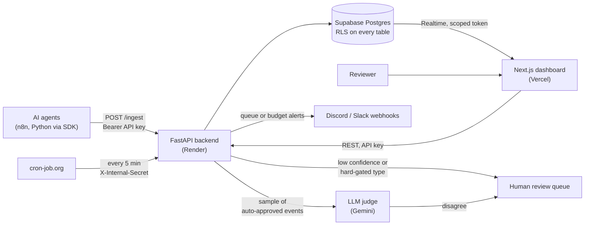
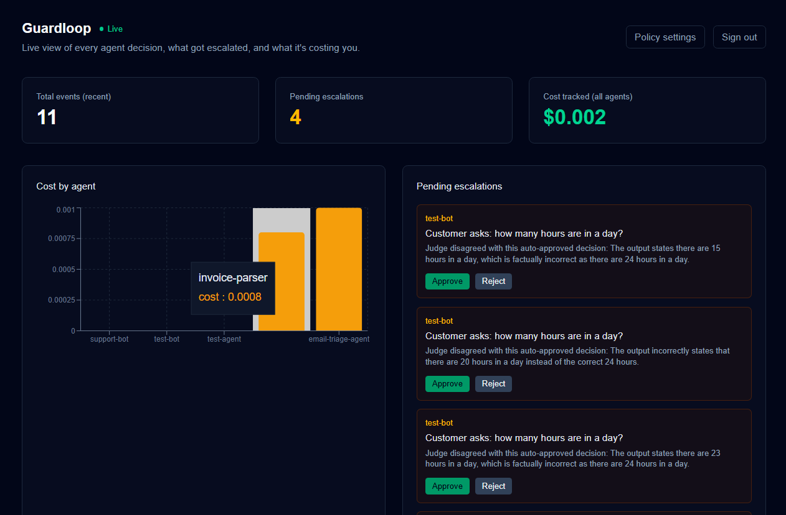
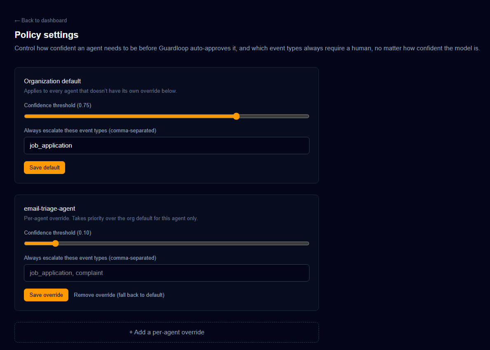
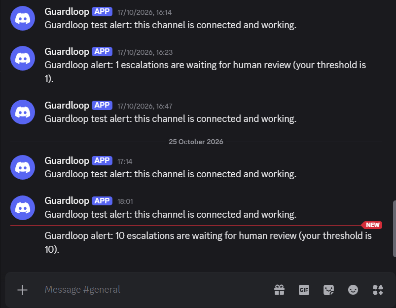
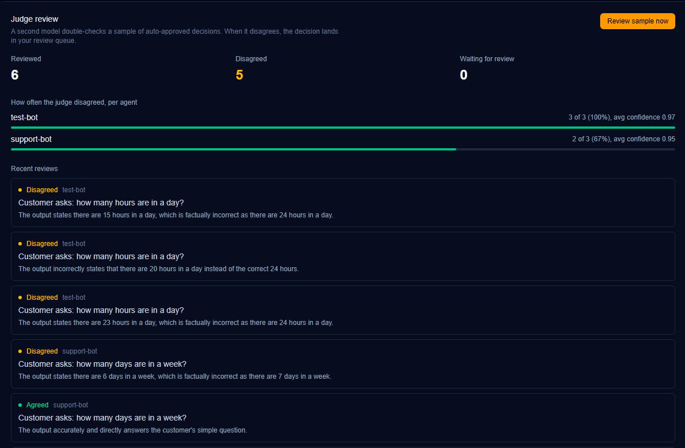
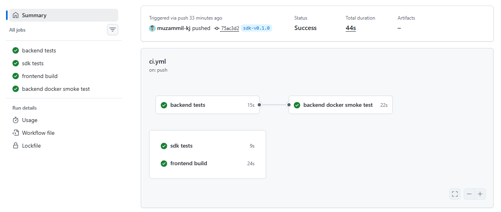

# Guardloop

[](https://github.com/muzammil-kj/guardloop/actions/workflows/ci.yml)

Guardrails and observability for AI agents.

Guardloop sits between your agents and the real world. Each agent reports its decisions to Guardloop, which decides whether a decision is safe to act on automatically or needs a person to review it. It tracks what the agents cost, alerts your team when reviews pile up or spend hits a budget, and uses a second model to double-check a sample of the decisions an agent was confident about.

- **Dashboard:** https://guardloop-iota.vercel.app
- **API docs (Swagger):** https://guardloop-api.onrender.com/docs

Create your own organization from the dashboard's **New organization** tab. You get an API key once, so save it.

---

## Why this exists

AI agents are often confidently wrong, and a team running several of them has no shared place to see their decisions, their escalations, or their spend. Most of the tooling is either a paid, closed platform or tied to one framework. Guardloop is a small, framework-agnostic layer: agents report over plain HTTP, and the Python SDK wraps the same call.

---

## What it does

| Area | What you get |
|---|---|
| **Organizations and API keys** | Sign up, get a key, create and revoke more keys. Keys are shown once; only a SHA-256 hash is stored. |
| **Policy engine** | An organization-wide default confidence threshold, per-agent overrides, and a list of event types that always need a human, no matter how confident the model is. |
| **Escalation queue** | Low-confidence or hard-gated decisions wait for a person to approve or reject them, with a reason attached. |
| **Python SDK** | `pip install guardloop-sdk`. Wraps the ingest call, returns an `approved` or `escalated` result, and raises a clear error if Guardloop is unreachable. |
| **Live dashboard** | Events and escalations update through Supabase Realtime, with a 15-second polling fallback if Realtime is unavailable. |
| **Alerts** | Discord or Slack messages when the review queue reaches a threshold or daily spend reaches a budget. Each rule waits an hour before alerting again on the same channel. |
| **LLM judge** | A second model re-checks a sample of auto-approved decisions. It never sees the agent's own confidence. When it disagrees, the decision goes to the review queue. Each agent gets a calibration view that flags agents whose confidence doesn't match the judge. |
| **Quality gates** | 137 backend tests, 6 SDK tests, a frontend production build, and a Docker smoke test run on every push. Deploys wait for green checks. |

---

## Architecture



**Stack:** FastAPI, Pydantic, Supabase (Postgres, Realtime, row-level security), Next.js 16, TypeScript, Tailwind, Recharts, Gemini API, Discord and Slack webhooks, GitHub Actions, Docker. Backend on Render, frontend on Vercel.

---

## How a decision flows

1. **Report.** An agent calls `POST /ingest` with its name, event type, confidence, and optional input and output summaries.
2. **Decide.** Guardloop picks the policy for that agent (its own, else the organization default, else the global default). The event is escalated if the agent asked for review, if its event type is on the hard-gate list, or if its confidence is below the threshold.
3. **Record.** The event and its status are stored, and the day's cost rolls up for that agent.
4. **Sample.** If the organization has the judge on, a share of auto-approved events with content is queued for review.
5. **Judge.** The judge model reads the event and returns `agree`, `disagree`, or `unsure`, with a score and a reason. A `disagree` is added to the review queue.
6. **Alert.** On each scheduled pass, Guardloop checks queue depth and daily spend for every enabled channel and posts to Discord or Slack when a limit is crossed.

---

## Quick start (local)

**Backend**

```powershell
cd backend
python -m venv .venv
.\.venv\Scripts\Activate.ps1
pip install -r requirements.txt
copy .env.example .env      # then fill in the values
python -m pytest tests/ -q
uvicorn app.main:app --reload --port 8000
```

**Frontend**

```powershell
cd frontend
npm install
copy .env.local.example .env.local   # then fill in the values
npm run dev
```

Open http://localhost:3000 for the dashboard and http://localhost:8000/docs for the API.

**Both, with Docker**

```powershell
docker compose up --build
```

Database setup: run the migrations in Supabase's SQL Editor, in this order: `PHASE2_MIGRATION.sql`, then `PHASE4_MIGRATION.sql`, then `PHASE5_MIGRATION.sql`. Phase 1 (`MIGRATION_PHASE1.sql`) comes first if you are upgrading the original MVP database. New projects can use `backend/app/db/schema.sql` for the base tables, followed by the phase migrations.

---

## Configuration

Names only. Real values belong in `.env` and in your hosting provider's settings, never in the repository.

**Backend**

| Variable | Required | Purpose |
|---|---|---|
| `SUPABASE_URL` | yes | Your Supabase project URL |
| `SUPABASE_SECRET_KEY` | yes | Server-side key. Never expose it to a browser. |
| `DEFAULT_CONFIDENCE_THRESHOLD` | no (0.75) | Used when an organization has no policy |
| `CORS_ALLOWED_ORIGINS` | no | Comma-separated browser origins allowed to call the API. Defaults to the production dashboard and `localhost:3000`. |
| `SUPABASE_JWT_SECRET` | for live updates | Signs the short-lived tokens the dashboard uses for Realtime |
| `INTERNAL_CRON_SECRET` | for scheduled jobs | Shared secret your scheduler sends in `X-Internal-Secret` |
| `GEMINI_API_KEY` | for the judge | Model key for the judge. Leave unset to disable it. |
| `JUDGE_MODEL` | no | Defaults to `gemini-3.5-flash-lite` |

**Frontend** (these are public by design, so use the public anon or publishable key only)

| Variable | Purpose |
|---|---|
| `NEXT_PUBLIC_API_URL` | Base URL of the backend, with no trailing slash |
| `NEXT_PUBLIC_SUPABASE_URL` | Supabase project URL, for Realtime |
| `NEXT_PUBLIC_SUPABASE_ANON_KEY` | Public key, for Realtime |

If an optional backend variable is missing, only its feature reports "not configured". The rest of the API keeps working.

---

## API reference

Every route below except `/health`, `POST /organizations`, and the two `/internal` routes needs `Authorization: Bearer <api key>`. The interactive version is at `/docs`.

| Method | Path | Purpose |
|---|---|---|
| GET | `/health` | Liveness check |
| POST | `/organizations` | Create an organization; returns its first API key once |
| GET | `/organizations/me` | The calling organization |
| GET | `/organizations/me/api-keys` | List keys (prefixes only) |
| POST | `/organizations/me/api-keys` | Create a key (returned once) |
| DELETE | `/organizations/me/api-keys/{key_id}` | Revoke a key |
| POST | `/organizations/me/realtime-token` | Short-lived token for live dashboard updates |
| POST | `/ingest` | Report an agent decision |
| GET | `/events` | Recent events |
| GET | `/escalations` | Escalations, filter by `status` |
| PATCH | `/escalations/{escalation_id}/resolve` | Approve, reject, or correct an escalation |
| GET | `/costs` | Daily cost per agent |
| GET | `/policies` | Organization and agent policies |
| PUT | `/policies/default` | Set the organization default |
| PUT | `/policies/{agent_name}` | Set an agent override |
| DELETE | `/policies/{agent_name}` | Remove an agent override |
| GET | `/alert-channels` | Alert channels (webhook URLs are masked) |
| POST | `/alert-channels` | Add a Discord or Slack channel |
| POST | `/alert-channels/{channel_id}/test` | Send a test message |
| DELETE | `/alert-channels/{channel_id}` | Remove a channel |
| GET | `/judge/settings` | Judge on or off, and sample rate |
| PUT | `/judge/settings` | Change judge settings |
| GET | `/judge/summary` | Totals and per-agent calibration |
| GET | `/judge/reviews` | Recent judge verdicts |
| POST | `/judge/run` | Review waiting events now (capped at 5) |
| POST | `/internal/run-checks` | Scheduled: alert checks for all channels |
| POST | `/internal/run-judge` | Scheduled: judge pass across all organizations |

---

## Security design

- **API keys** are 32 random bytes with a `gl_live_` prefix. Only the SHA-256 hash is stored, so a database leak doesn't expose usable keys.
- **Tenant isolation.** Every query is filtered by the calling organization's ID, taken from the verified key.
- **CORS.** Browsers can only call the API from the dashboard's origin and from localhost during development. Server-side callers, such as agents and the SDK, are not affected by CORS.
- **Row-level security** is enabled on every table. The browser only ever holds a one-hour token that can read its own organization's events and escalations.
- **Webhook safety.** Webhook URLs must be HTTPS and must point at Discord or Slack. Redirects are disabled, and the full URL is never returned by the API. This stops the server being used to reach internal addresses.
- **Scheduled endpoints** require a shared secret compared in constant time. They refuse every request if no secret is configured.
- **Judge hardening.** The agent's own confidence is hidden from the judge. Event text is wrapped in delimiters that the text can't close. Verdicts are parsed strictly, so anything malformed is an error and never counts as "agree". The model key travels in a header, not the URL.
- **Fail-open ingestion.** A broken judge or missing judge table never stops an agent's call from being recorded.

---

## Testing and CI

- **Backend:** 137 tests with mocked network calls. They cover auth, policy resolution, escalation rules, webhook validation, alert debounce, the judge's prompt construction, verdict parsing, the review loop, CORS, and the HTTP routes.
- **SDK:** 6 tests.
- **Frontend:** a production build, which also type-checks every page.
- **Docker:** the backend image is built and started, and `/health` must respond.

During development the four most safety-critical behaviours were broken on purpose, one at a time (the atomic claim that stops double review, the prompt delimiter, the fail-open guard, and strict verdict parsing). The suite failed each time, which is how I know those tests can catch a regression.

Deploys on Render wait for CI to pass. `main` is protected, so changes arrive through pull requests with green checks.

---

## Known limitations

- **The judge is another LLM.** Its disagreement is a signal to look at, not ground truth. Its accuracy has not been measured against human labels yet.
- **Judge data leaves your infrastructure.** For each reviewed event, the agent name, event type, and input and output summaries are sent to Google's Gemini API. Enable it only when that is allowed. The settings page says so.
- **Judge spend has no global cap.** Limits are per run (5 for a manual run, 20 per scheduled pass), not per day.
- **No user accounts yet.** Access is by organization API key. The dashboard keeps that key in the browser's local storage, which is convenient for a demo but is not a production login.
- **No rate limiting** on `/ingest` yet.
- **Free hosting.** Render sleeps when idle. The five-minute scheduled job keeps the service awake but isn't a guarantee of uptime.
- **Scheduling depends on an external service** (cron-job.org).
- **Alert timing is fixed** at one hour per channel and rule, and the calibration flag (at least 5 reviews and a 20% disagreement rate) is set in code.

---

## Roadmap

- Add rate limiting on ingest
- User accounts and role-based access for reviewers
- A daily spend cap for the judge
- Measure judge accuracy against human-labelled decisions
- Integrations for more agent frameworks

---

## Repository layout

```
backend/        FastAPI app: app/api, app/auth, app/alerts, app/judge, app/policies, tests/
frontend/       Next.js dashboard: app/dashboard, lib/
sdk/            guardloop-sdk Python client (see sdk/README.md)
docker-compose.yml
.github/workflows/ci.yml
```

---


## Screenshots

### Live Dashboard


### Policy Settings


### Discord Alerts


### Judge Review Panel


### CI Checks



---

## Author

Muzammil Khan. The SDK is released under the MIT license as declared in `sdk/pyproject.toml`.